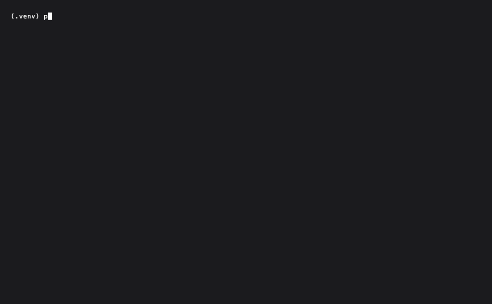

[简体中文](./README.md) · [Website](https://subjectpurge.lei6393.com) · [GitHub](https://github.com/SuperMarioYL/subjectpurge)

<picture>
  <source media="(max-width: 600px) and (prefers-color-scheme: dark)" srcset="./assets/presentation/hero-mobile-dark.svg">
  <source media="(max-width: 600px)" srcset="./assets/presentation/hero-mobile-light.svg">
  <source media="(prefers-color-scheme: dark)" srcset="./assets/presentation/hero-dark.svg">
  
</picture>

# subjectpurge

**Find a subject identifier across your configured stores.**

SubjectPurge scans registered stores for an explicit subject identifier and collects matching locations into a structured residue map.

## Why use it

A contact identifier can appear in a note row and a trace line. One store registry lets an operator locate those references together before deciding what a deletion workflow must handle.

- **One store registry** — Configured adapters share a locate interface.
- **Traceable locations** — Each hit carries a store locator and evidence hash.
- **Read before deletion** — The current scan produces a reviewable location map.

## Architecture

<picture>
  <source media="(max-width: 600px) and (prefers-color-scheme: dark)" srcset="./assets/presentation/architecture-mobile-dark.svg">
  <source media="(max-width: 600px)" srcset="./assets/presentation/architecture-mobile-light.svg">
  <source media="(prefers-color-scheme: dark)" srcset="./assets/presentation/architecture-dark.svg">
  
</picture>

StoreConfig constructs a supported adapter for each entry. Scanner calls locate, collects ResidueHit objects and closes adapters. Hits retain store, locator, match category and evidence hash; write_residue_map serializes the result.

| Component | Responsibility |
| --- | --- |
| `Store registry` | subjectpurge/config.py |
| `Read adapters` | SQLite / trace / optional Chroma |
| `Subject scanner` | subjectpurge/scanner.py |
| `ResidueMap` | Matched locations and hashes |

## Install and quickstart

Build with the version declared in the repository manifest. Run the example from the repository root.

```bash
git clone https://github.com/SuperMarioYL/subjectpurge.git
cd subjectpurge
uv venv .venv
uv pip install --python .venv/bin/python -e .
source .venv/bin/activate
```

Create temporary SQLite and trace inputs containing demo@example.com, locate matches, and confirm the database still has both original rows.

```bash
.venv/bin/python examples/presentation-demo.py
```

## Recorded demo

<picture>
  <source media="(max-width: 600px) and (prefers-color-scheme: dark)" srcset="./assets/presentation/process-mobile-dark.svg">
  <source media="(max-width: 600px)" srcset="./assets/presentation/process-mobile-light.svg">
  <source media="(prefers-color-scheme: dark)" srcset="./assets/presentation/process-dark.svg">
  
</picture>

The subject is located in both stores while the SQLite row count remains unchanged.

```text
{
  "subject": "demo@example.com",
  "hits": [
    {
      "store": "notes",
      "adapter": "sqlite",
      "kind": "embedded"
    },
    {
      "store": "traces",
      "adapter": "trace_text",
      "kind": "trace_ref"
    }
  ]
}
database rows after scan: 2
```

The complete command and output are recorded in [docs/demo-results.json](./docs/demo-results.json). Inputs and reproduction code are included in the repository.



The existing recording is retained for context; the text example above documents the reproducible scenario.

## Usage

The CLI exposes the following operations. Commands after the example use your own paths or identifiers.

```bash
subjectpurge scan --subject demo@example.com --config stores.yaml --out residue_map.json
```

## Configuration

stores.yaml lists id, kind, path or glob and adapter settings. SQLite uses table and text_columns; Chroma uses collection and requires the optional chroma extra. graph is declared in the schema but no built-in adapter is registered. operator and law_ref are metadata, not compliance validation.

## Integrations and responsibilities

<picture>
  <source media="(max-width: 600px) and (prefers-color-scheme: dark)" srcset="./assets/presentation/integrations-mobile-dark.svg">
  <source media="(max-width: 600px)" srcset="./assets/presentation/integrations-mobile-light.svg">
  <source media="(prefers-color-scheme: dark)" srcset="./assets/presentation/integrations-dark.svg">
  
</picture>

The following routes are implemented in the source. Choose the input that matches your task and keep the resulting artifact with your project.

| Route | Implemented role |
| --- | --- |
| SQLite | Configured text columns |
| Trace text | Configured local glob |
| Chroma optional extra | Stored document matching |
| Residue JSON | Location map for review |

## Limits and next steps

- purge, audit and verify are unimplemented milestones. The current release locates references but does not delete them or issue a signed audit proof.
- Exact identifier matching can miss paraphrases or transformed identifiers. A scan cannot establish that every personal-data residue has been found.
- The demo only uses temporary SQLite and text files with a reserved example email. No live store is accessed.

Per-hit deletion, chained lineage and signed audit output are future milestones requiring separate implementation and verification.

## License and contributions

See [LICENSE](./LICENSE). When reporting an issue, include a minimal input, the command, and the observed output.
