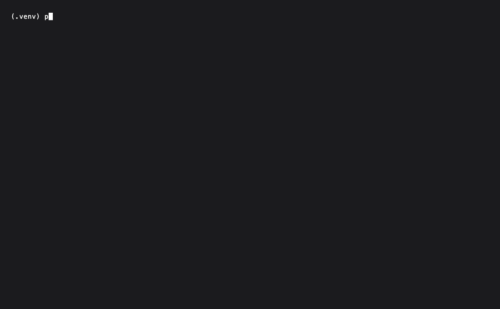

[English](./README.en.md) · [Website](https://subjectpurge.lei6393.com) · [GitHub](https://github.com/SuperMarioYL/subjectpurge)

<picture>
  <source media="(max-width: 600px) and (prefers-color-scheme: dark)" srcset="./assets/presentation/hero-mobile-dark.svg">
  <source media="(max-width: 600px)" srcset="./assets/presentation/hero-mobile-light.svg">
  <source media="(prefers-color-scheme: dark)" srcset="./assets/presentation/hero-dark.svg">
  
</picture>

# subjectpurge

**在配置的存储中定位主体标识。**

SubjectPurge 在登记存储中扫描明确主体标识，将匹配位置汇总为结构化残留地图。

## 为什么需要它

联系标识可能同时出现在笔记行和轨迹行。一份存储登记表让操作者先集中定位这些引用，再确定删除流程需要处理什么。

- **统一存储登记** — 配置适配器共用 locate 接口。
- **可追踪位置** — 每个命中携带存储位置与证据哈希。
- **先读取再决定删除** — 当前扫描生成可检查的位置地图。

## 架构

<picture>
  <source media="(max-width: 600px) and (prefers-color-scheme: dark)" srcset="./assets/presentation/architecture-mobile-dark.svg">
  <source media="(max-width: 600px)" srcset="./assets/presentation/architecture-mobile-light.svg">
  <source media="(prefers-color-scheme: dark)" srcset="./assets/presentation/architecture-dark.svg">
  
</picture>

StoreConfig 为每个条目创建支持的适配器。Scanner 调用 locate、收集 ResidueHit 并关闭适配器。命中保留存储、定位、类别与证据哈希，write_residue_map 将结果序列化。

| 组件 | 职责 |
| --- | --- |
| `Store registry` | subjectpurge/config.py |
| `Read adapters` | SQLite / trace / optional Chroma |
| `Subject scanner` | subjectpurge/scanner.py |
| `ResidueMap` | Matched locations and hashes |

## 安装与快速上手

使用仓库清单指定的运行时版本构建，并在仓库根目录运行示例。

```bash
git clone https://github.com/SuperMarioYL/subjectpurge.git
cd subjectpurge
uv venv .venv
uv pip install --python .venv/bin/python -e .
source .venv/bin/activate
```

创建含 demo@example.com 的临时 SQLite 与轨迹输入，定位匹配，并确认数据库仍保留两条原始记录。

```bash
.venv/bin/python examples/presentation-demo.py
```

## 实际运行示例

<picture>
  <source media="(max-width: 600px) and (prefers-color-scheme: dark)" srcset="./assets/presentation/process-mobile-dark.svg">
  <source media="(max-width: 600px)" srcset="./assets/presentation/process-mobile-light.svg">
  <source media="(prefers-color-scheme: dark)" srcset="./assets/presentation/process-dark.svg">
  
</picture>

The subject is located in both stores while the SQLite row count remains unchanged.

```text
{
  "subject": "demo@example.com",
  "hits": [
    {
      "store": "notes",
      "adapter": "sqlite",
      "kind": "embedded"
    },
    {
      "store": "traces",
      "adapter": "trace_text",
      "kind": "trace_ref"
    }
  ]
}
database rows after scan: 2
```

完整命令与输出保存在 [docs/demo-results.json](./docs/demo-results.json). 输入和复现代码均随仓提供。



保留已有录制供参考；上方文字示例给出当前可复现的操作。

## 用法

CLI 提供以下操作。示例之外的命令需要替换成你的文件路径或标识。

```bash
subjectpurge scan --subject demo@example.com --config stores.yaml --out residue_map.json
```

## 配置

stores.yaml 列出 id、kind、path 或 glob 与适配设置。SQLite 使用 table 和 text_columns；Chroma 使用 collection 并需要可选 chroma 依赖。schema 声明 graph，但未注册内置适配器。operator 与 law_ref 是元数据，不执行合规验证。

## 集成与职责分工

<picture>
  <source media="(max-width: 600px) and (prefers-color-scheme: dark)" srcset="./assets/presentation/integrations-mobile-dark.svg">
  <source media="(max-width: 600px)" srcset="./assets/presentation/integrations-mobile-light.svg">
  <source media="(prefers-color-scheme: dark)" srcset="./assets/presentation/integrations-dark.svg">
  
</picture>

以下路径已有源码实现。按任务选择输入，并把生成的结果与项目一起保存。

| 路径 | 已实现职责 |
| --- | --- |
| SQLite | Configured text columns |
| Trace text | Configured local glob |
| Chroma optional extra | Stored document matching |
| Residue JSON | Location map for review |

## 限制与后续方向

- purge、audit 与 verify 尚未实现。当前版本定位引用，不删除数据，也不签发审计证明。
- 精确标识匹配可能漏掉改写或变换后的标识；扫描不能证明已找到全部个人数据残留。
- 示例只使用临时 SQLite、文本文件及保留示例邮箱，不访问在线存储。

逐命中删除、链式溯源和签名审计输出属于后续里程碑，需要分别实现与验证。

## 许可与贡献

许可见 [LICENSE](./LICENSE). 反馈问题时请提供最小输入、执行命令和实际输出。
